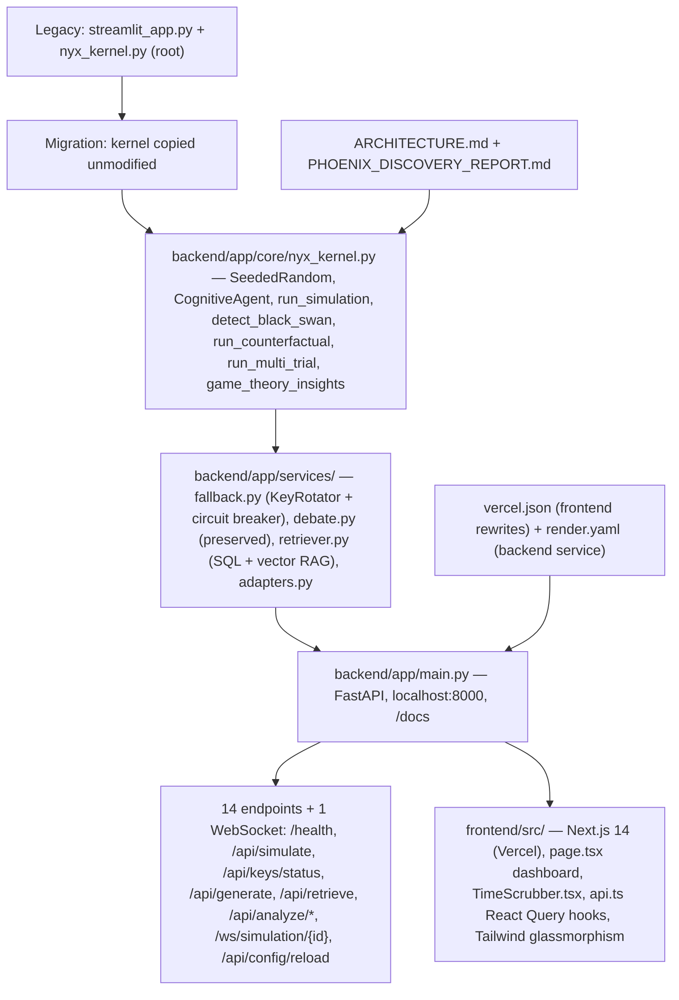

# NYX Phoenix Migration - Enterprise Multi-Agent Simulation Platform

## 🚀 Overview

This is the **complete migration** of the legacy Streamlit-based NYX Decision Intelligence Simulator into a modern, decoupled N-tier architecture. The new platform features:

- **Next.js 14 Frontend** - Deployable on Vercel with stunning glassmorphism UI
- **FastAPI Backend** - Async Python backend with circuit breaker protection
- **Enhanced KeyRotator** - Intelligent multi-provider LLM fallback with weighted round-robin
- **Real-time Streaming** - WebSocket support for live simulation monitoring
- **Database Integration** - SQL + Vector DB support for RAG (Retrieval Augmented Generation)

---

## 📁 Project Structure

```
/workspace
├── backend/                    # FastAPI Backend (Render/Fly.io)
│   ├── app/
│   │   ├── core/
│   │   │   └── nyx_kernel.py   # PRESERVED: Original simulation engine
│   │   ├── services/
│   │   │   ├── fallback.py     # ENHANCED: KeyRotator with Circuit Breaker
│   │   │   ├── retriever.py    # NEW: Database/Vector DB scanner
│   │   │   └── debate.py       # PRESERVED: Debate orchestration
│   │   ├── db/                 # Database models (future)
│   │   └── main.py             # FastAPI application entry point
│   └── requirements.txt        # Python dependencies
│
├── frontend/                   # Next.js Frontend (Vercel)
│   ├── src/
│   │   ├── app/
│   │   │   ├── page.tsx        # Main dashboard component
│   │   │   ├── layout.tsx      # Root layout with React Query
│   │   │   └── globals.css     # Tailwind + custom styles
│   │   └── lib/
│   │       └── api.ts          # React Query hooks for API calls
│   ├── public/
│   │   └── _redirects          # SPA routing for Netlify/Vercel
│   ├── package.json
│   ├── next.config.js
│   └── tailwind.config.js
│
├── vercel.json                 # Vercel rewrites to backend
├── render.yaml                 # Render deployment config
├── .env.example                # Environment variable template
└── ARCHITECTURE.md             # Detailed architecture diagrams
```

---

## 🎯 Key Features Preserved & Enhanced

### 1. Golden Core (Zero Logic Loss)
The original `nyx_kernel.py` is **directly copied** into `backend/app/core/` without modification:
- `SeededRandom` - Deterministic PRNG
- `CognitiveAgent` - 10-variable psychological model
- `run_simulation()` - Main simulation orchestrator
- `detect_black_swan()` - Fragility analysis
- `run_counterfactual()` - What-if scenarios
- `run_multi_trial()` - Statistical aggregation
- `game_theory_insights()` - Nash equilibrium analysis

### 2. Enhanced KeyRotator (with Circuit Breaker)
The original `generate_with_fallback()` logic is preserved but enhanced with:
- **Circuit Breaker Pattern** - Prevents repeated calls to failing providers
- **Weighted Round-Robin** - Adapts priority based on success rates
- **Rate Limit Tracking** - Remembers 429 errors and applies cooldown
- **Hot-Reload Configuration** - Add new keys without server restart

### 3. New Database Retriever (Oracle)
Greenfield implementation for RAG functionality:
- SQLAlchemy adapter for SQL databases (PostgreSQL, SQLite)
- Vector DB adapters (Qdrant, Pinecone ready)
- Hybrid search combining both sources
- Async I/O for non-blocking retrieval

---

## 🛠️ Quick Start

### Backend Setup

```bash
cd /workspace/backend

# Create virtual environment
python -m venv venv
source venv/bin/activate  # or `venv\Scripts\activate` on Windows

# Install dependencies
pip install -r requirements.txt

# Copy environment template
cp ../.env.example .env

# Edit .env and add your API keys
# GROQ_API_KEY=your_key_here
# GEMINI_API_KEY=your_key_here
# etc.

# Run the backend
uvicorn app.main:app --reload --host 0.0.0.0 --port 8000
```

Backend will be available at: `http://localhost:8000`
API docs at: `http://localhost:8000/docs`

### Frontend Setup

```bash
cd /workspace/frontend

# Install dependencies
npm install

# Create environment file
cp .env.example .env.local

# Run development server
npm run dev
```

Frontend will be available at: `http://localhost:3000`

---

## 🌐 Deployment

### Frontend (Vercel)

1. Push code to GitHub
2. Import project in Vercel
3. Set build command: `npm run build`
4. Set output directory: `dist`
5. Add environment variable: `NEXT_PUBLIC_BACKEND_URL=https://your-backend.onrender.com`

Vercel will automatically use `vercel.json` for API rewrites.

### Backend (Render)

1. Push code to GitHub
2. Create new Web Service in Render
3. Connect repository
4. Build command: `pip install -r backend/requirements.txt`
5. Start command: `cd backend && uvicorn app.main:app --host 0.0.0.0 --port $PORT`
6. Add all API key environment variables from `.env.example`

---

## 🔌 API Endpoints

| Endpoint | Method | Description |
|----------|--------|-------------|
| `/health` | GET | Basic health check |
| `/health/ready` | GET | Readiness check with dependency verification |
| `/api/simulate` | POST | Run cognitive-social simulation |
| `/api/simulate/{id}` | GET | Retrieve simulation by ID |
| `/api/keys/status` | GET | Get API key health dashboard data |
| `/api/keys/reset/{name}` | POST | Reset circuit breaker for provider |
| `/api/generate` | POST | Generate text with LLM fallback |
| `/api/retrieve` | POST | Retrieve context from database (RAG) |
| `/api/analyze/black-swan` | POST | Detect fragile assumptions |
| `/api/analyze/counterfactual` | POST | Run what-if scenario |
| `/api/analyze/multi-trial` | POST | Run multiple trials |
| `/api/analyze/game-theory` | POST | Compute Nash equilibria |
| `/ws/simulation/{id}` | WebSocket | Real-time simulation streaming |
| `/api/config/reload` | POST | Hot-reload API keys from env |

---

## 🔐 Security

- All API keys stored in environment variables (never committed)
- CORS configured for specific origins in production
- Input validation via Pydantic models
- 503 errors returned for invalid configurations (never crashes)

---

## 📊 Architecture Highlights

See `ARCHITECTURE.md` for detailed Mermaid diagrams showing:
- N-tier component relationships
- Data flow sequences
- Deployment topology
- Security boundaries

---

## 🎨 UI Features

- **Glassmorphism Design** - Lavender haze aesthetic matching original Streamlit app
- **Live Key Health Dashboard** - Real-time provider status with success rates
- **Agent State Cards** - Visual display of agent psychological states
- **Mode Badges** - Color-coded agent mode indicators (EXECUTE, AVOID, RECOVER, etc.)
- **Outcome Vector Metrics** - Four-key performance indicators

---

## 🧪 Testing

```bash
# Backend tests (when added)
cd backend
pytest

# Frontend tests
cd frontend
npm test
```

---

## 📝 Migration Checklist

- [x] Discovery Report completed
- [x] Golden Core identified and preserved
- [x] KeyRotator enhanced with Circuit Breaker
- [x] Database Retriever implemented
- [x] FastAPI backend created
- [x] Next.js frontend created
- [x] Vercel/Render configs created
- [ ] Unit tests for backend services
- [ ] E2E tests for critical flows
- [ ] Load testing documentation
- [ ] Monitoring/alerting setup

---

## 🙏 Credits

Original Streamlit application and NYX Kernel preserved intact.
This migration enhances rather than replaces the core simulation logic.

---

*Built with ❤️ by Principal Staff Architect & Cognitive Systems Engineer*

## 🗺️ Project map



## 📊 At a glance (facts checked against the repo 30 Oct 2026; deployment and API claims as recorded in the README)

| Measure | Value |
|---|---|
| What | Enterprise multi-agent simulation platform — the NYX Decision Intelligence Simulator migrated from Streamlit to a decoupled N-tier architecture |
| Frontend | Next.js 14, Tailwind glassmorphism ("lavender haze"), dashboard page + TimeScrubber component, React Query hooks in src/lib/api.ts; dev server localhost:3000 |
| Backend | FastAPI (async), entry backend/app/main.py; dev server localhost:8000, docs at /docs |
| Golden core | backend/app/core/nyx_kernel.py is the original kernel copied without modification: SeededRandom deterministic PRNG, CognitiveAgent 10-variable psychological model, run_simulation, detect_black_swan, run_counterfactual, run_multi_trial, game_theory_insights |
| KeyRotator | Enhanced generate_with_fallback: circuit breaker, weighted round-robin by success rate, 429 rate-limit tracking with cooldown, hot-reload of keys without restart |
| Retriever (Oracle) | Greenfield RAG: SQLAlchemy (PostgreSQL, SQLite) + vector adapters (Qdrant, Pinecone ready), hybrid search, async I/O |
| Real-time | WebSocket /ws/simulation/{id} for live simulation streaming; live key-health dashboard with success rates |
| API | 14 HTTP endpoints + 1 WebSocket (see map): health, simulate, keys status/reset, generate, retrieve, black-swan / counterfactual / multi-trial / game-theory analysis, config reload |
| UI features | Agent state cards, mode badges (EXECUTE, AVOID, RECOVER, ...), four-key outcome vector metrics |
| Security | Keys in environment variables only (never committed), CORS for specific origins in production, Pydantic input validation, 503 on invalid config instead of crashing |
| Deployment | Frontend: Vercel (vercel.json rewrites, NEXT_PUBLIC_BACKEND_URL env); backend: Render web service (render.yaml, uvicorn app.main:app); no live deployment URL is claimed in the README |
| Files | 35: backend (main, core, services, db, requirements), frontend (Next.js app, components, lib, configs), root legacy streamlit_app.py + nyx_kernel.py, ARCHITECTURE.md, PHOENIX_DISCOVERY_REPORT.md, render.yaml, vercel.json |
